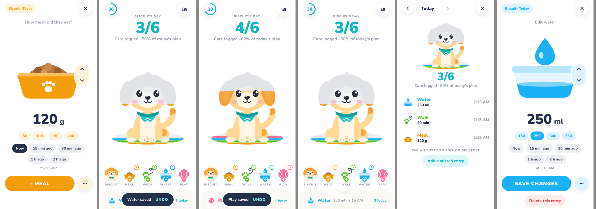

# PAVURIO

A little world for all their big moments. Pavurio is a pet care companion for iOS and Android with an original, code-animated dog and cat (no AI features).

Its design comes from [Waterllama](https://refero.design/apps/274), studied through the Refero MCP. **The pet is the progress bar.** Each day your pet starts as a soft pencil sketch. Every care you log colors in more of them, using their real palette. See [`docs/research/REFERENCE_BOARD.md`](docs/research/REFERENCE_BOARD.md).



## What works today (milestone M2: vertical slice)

| Area | Status |
|---|---|
| Onboarding: welcome, choose dog or cat, name, coat and bandana/collar, daily plan | ✅ |
| Home: big `done/planned` number, layered pet that colors in, banded care rug, quick-add row, today peek card | ✅ |
| Interactive pet: breathing, tail, random blinks, ear twitches, eyes and head follow your finger, tap bounce with hearts | ✅ |
| Log card (full screen): illustration that reacts to the amount, up/down control, presets, time chips, note, `+ MEAL` pill | ✅ |
| Real persistence: SQLite transaction, idempotent `mutation_id` (stops double-tap duplicates), validation | ✅ |
| The pet celebrates **only after** a save succeeds; a 6 s **Undo** snackbar soft-voids the record | ✅ |
| Day detail: browse past days, edit or delete entries, add a missed entry at the right time | ✅ |
| Character Studio, Settings (plan, haptics, reduce motion, JSON export, erase all) | ✅ |
| Data survives a full restart (automated test plus a browser reload check) | ✅ |
| Reminders and notifications, records, Moments and Stories, paywall, widgets, Live Activity | ⏭ next milestones (see below) |

## Stack

Expo SDK 58 · React Native 0.88 · TypeScript · Expo Router (`src/app`) · expo-sqlite · Reanimated 4 · react-native-svg · expo-haptics · Nunito (OFL)

```
src/app/          routes: index (Home), onboarding, log/[type], day, studio, settings
src/animation/    art.tsx (layered vector dog and cat), PetRig, usePetMotion (controller), Burst, PetAvatar
src/domain/       care templates, progress (plan-based, never a welfare score), time (local-day calendar math)
src/data/         Db interface, migrations (PRAGMA user_version), repositories
src/state/        AppProvider + useDay
src/ui/           theme tokens, primitives, care illustrations
tests/            vitest; repositories run on a real SQLite file through node:sqlite
docs/             specs, Refero reference board, art reference, screenshots
```

## Run it

```bash
npm install
npx expo start          # press i / a / w
npm test                # 18 domain and database tests
npm run typecheck
```

Expo Go works for this slice. Later milestones (RevenueCat, widgets, Live Activities) need a development build: `npx expo run:ios` / `npx expo run:android` or `eas build --profile development`.

On web, expo-sqlite needs the COOP/COEP headers that are already set in `metro.config.js`.

## Product rules kept in code

- A care record is saved first. Animation is only a reaction to it, and can be turned off without changing any data.
- Progress means "share of **your** plan logged today". It is never a health or welfare score, and the sketch state is neutral (the pet's face stays happy).
- Care is never logged in the future. Instants are stored in UTC; days use local calendar math, so they stay correct across DST.
- All data stays on the device. Export and erase work offline.

## Next milestones

- **M3:** recurring schedules and local reminders (permission explained before the OS prompt), appointments.
- **M4:** records (vet visits and vaccines, with source and provenance), Moments photo scrapbook.
- **M5:** Stories (9:16 recap player and static export, with a privacy checklist).
- **M6:** RevenueCat with real store products, then widgets and a walk Live Activity.

Specs live in [`docs/specs`](docs/specs).
